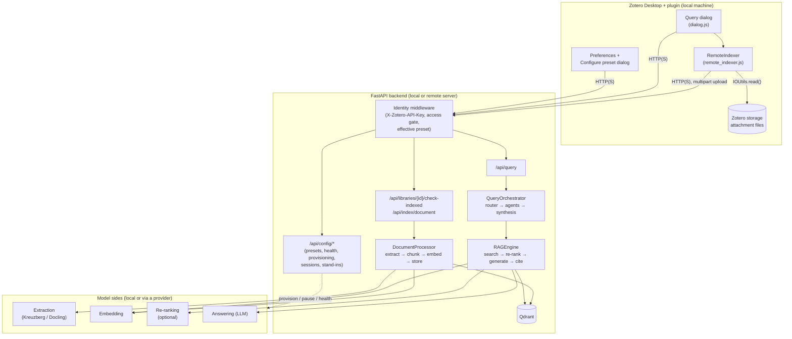
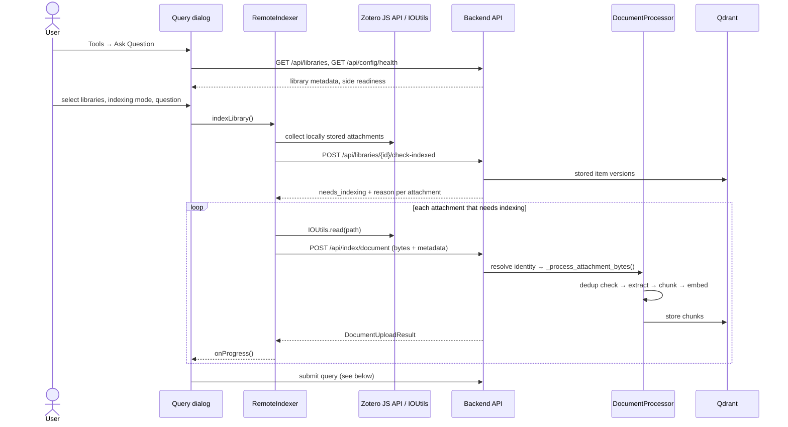
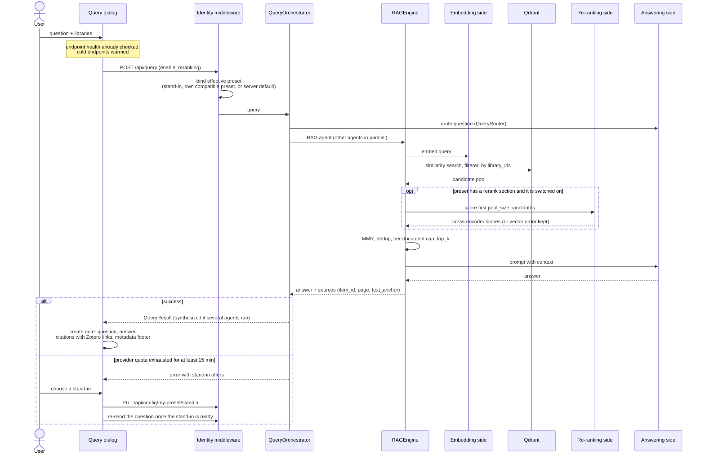

# Zotero RAG Application - Architecture Documentation

## Table of Contents

- [Overview](#overview)
- [System Architecture](#system-architecture)
- [Component Details](#component-details)
  - [Backend Services](#backend-services)
  - [Zotero Plugin](#zotero-plugin)
- [Data Flow](#data-flow)
- [Configuration System](#configuration-system)
- [Key Design Decisions](#key-design-decisions)
- [Performance Considerations](#performance-considerations)
- [Security & Privacy](#security--privacy)

---

## Overview

The Zotero RAG Application is a Retrieval-Augmented Generation (RAG) system that integrates with Zotero to enable semantic search and question answering across your research library. The system consists of two main components:

1. **FastAPI Backend**: Python-based service handling document indexing, vector search, and LLM inference
2. **Zotero Plugin**: JavaScript plugin providing a user interface within Zotero

The backend can run locally or on a remote server. Indexing is push-based: the plugin reads attachment bytes from Zotero's local storage and uploads them to the backend via HTTP. The backend requires no access to Zotero or the local filesystem.

### Key Features

- **Semantic Search**: Ask natural language questions about your research library
- **Multi-Library Support**: Query across multiple Zotero libraries simultaneously
- **Query Routing**: A router sends each question to one or more agents (full-text RAG, metadata, mentions) and synthesizes their answers (see [Query Routing & Agent Architecture](query-routing.md))
- **Local & Remote Models**: Local models (quantized) or remote providers (OpenAI-compatible APIs, Anthropic, Google Gemini, KISSKI, MPCDF, and self-provisioned RunPod / Hugging Face endpoints), chosen separately for embeddings, re-ranking and answers
- **Optional Re-ranking**: A cross-encoder, local or on a remote `/rerank` endpoint, rescores the vector-search candidates before the answer is generated
- **Smart Citations**: Answers include source citations with page numbers and text anchors
- **Real-Time Progress**: Live progress updates during library indexing
- **Flexible Configuration**: JSON presets select a provider per side; each user can run on their own compatible preset and keys
- **Stand-in Presets**: When a provider's quota is used up for a while, the plugin offers an equivalent preset until it resets
- **Remote Server Support**: Backend can run on a separate machine with optional API key authentication

### Technology Stack

**Backend:**

- Python 3.12 with `uv` package manager
- FastAPI for REST API
- Qdrant for vector database
- sentence-transformers for local embeddings and local cross-encoder re-ranking
- transformers + bitsandbytes for local LLM inference
- Kreuzberg for document extraction (PDF, HTML, DOCX, EPUB; Rust-based, native async)
- python-multipart for document upload

**Plugin:**

- JavaScript (Firefox extension environment)
- Zotero 7/8 plugin architecture
- HTML5 + CSS3 for UI (no XUL dependency)
- IOUtils API for local file reading (remote mode upload)

---

## System Architecture

### Architecture



**Backend URL:** stored in the `extensions.zotero-rag.backendURL` Zotero preference (configurable in the Preferences pane, default `http://localhost:8119`). Remote (non-loopback) backends require every caller to authenticate with a personal Zotero API key, entered in the plugin preferences and stored as `extensions.zotero-rag.zoteroApiKey` — see [Security & Privacy](#security--privacy).

---

## Component Details

### Backend Services

The backend is organized into a layered architecture with clear separation of concerns:

#### 1. API Layer

**Entry Point:** [backend/main.py](../backend/main.py)

- FastAPI application setup
- Zotero-key identity middleware on every `/api/*` request except `/api/version` (routes outside `/api/` are unauthenticated) — see [Security & Privacy](#security--privacy)
- Configurable CORS (`ALLOWED_ORIGINS` env var)
- Lifespan context management, including loading the [backend plugins](backend-plugins.md) and running their startup and shutdown hooks

**Service routes:** [backend/api/status.py](../backend/api/status.py), unauthenticated, for the server's default preset

- `GET /status` - Version, preset, retrieval settings, vector store counts, auto-indexing state, and the loaded backend plugins with the capabilities they registered (`plugins`, `capabilities`, `plugin_dirs`)
- `GET /sides` - Each side of the default preset (embedding, answering, optional re-ranking): model, endpoint URL, side-specific settings and `served_by` (the capability and plugin serving it, and whether it is available)
- `GET /health` - Reachability of the Kreuzberg and Qdrant sidecars
- `GET /` - Service name, version and links to the routes above

**Configuration API:** [backend/api/config.py](../backend/api/config.py)

- `GET /api/config` - Available presets, the server default and the compatible/switchable ones
- `POST /api/config` - Admin: switch the server default preset (credentials are not required; the preset is simply not ready until they are set)
- `GET /PUT /api/config/my-preset` - The caller's own preset choice among compatible presets
- `GET /api/config/providers` - Per-side provider descriptors (capabilities, credential scope, provisioning credential)
- `PUT /DELETE /api/config/my-preset/standin` - Switch the caller to an offered stand-in preset until the exhausted quota resets, or end the switch early
- `GET /api/config/preset-view` - The "Configure preset" dialog's view model: one tab per side in pipeline order (extraction, embedding, retrieval, re-ranking when the preset has one, answering) with state, fields, messages, job log and actions, and one account card per service provider (`backend/services/preset_view.py`, types in `backend/providers/ui.py`)
- `GET /api/config/health` - Readiness of each remote side, the re-ranking side included (`ready` / `cold` / `throttled` / `paused` / `unreachable`)
- `POST /api/config/provision`, `POST /api/config/suspend` - Create/resume and pause an endpoint (background jobs, one per side and slot); provisioning all sides leaves the re-ranking endpoint alone, pausing all includes it
- `POST /api/config/warmup` - Wake the caller's cold endpoints (called when the question dialog opens)
- `POST /api/config/session/login`, `POST /api/config/session/logout`, `GET /api/config/session` - Per-user provider sessions (MPCDF); a login starts the endpoints that account serves, re-ranking included unless the user switched it off
- `GET /api/models/status` - Per-model demand of a remote LLM provider (traffic light in the query dialog)
- `GET /api/version` - Version compatibility checking (exempt from identity check)

**Libraries API:** [backend/api/libraries.py](../backend/api/libraries.py)

- `GET /api/libraries` — List all libraries known to the backend (indexed or registered). Returns `LibraryDetailResponse` for each: combined index metadata (`total_items_indexed`, `total_chunks`, `last_indexed_at`, `indexing_mode`), registration info (`registered_at`, `users[]`), library name and type. Union of indexed and registered libraries, sorted by ID.
- `GET /api/libraries/{library_id}/status` — Same `LibraryDetailResponse` shape for a single library. Returns 404 if the library is neither indexed nor registered.
- `GET /api/libraries/{library_id}/index-status` — Raw `LibraryIndexMetadata` for the plugin's sync-state tracking (last indexed version, item/chunk counts, force-reindex flag). Returns 404 if never indexed.
- `DELETE /api/libraries/{library_id}/index` — Remove all indexed data for a library (chunks, dedup records, metadata). Returns deletion counts.
- `DELETE /api/libraries/{library_id}/items/{item_key}/chunks` — Remove all indexed chunks for a specific item (called automatically when an item is permanently deleted in Zotero).

**Indexing API:** [backend/api/indexing.py](../backend/api/indexing.py)

- `POST /api/index/library/{library_id}` — **410 Gone** (pull-based indexing removed)
- `GET /api/index/library/{library_id}/progress` — **410 Gone**
- `POST /api/index/library/{library_id}/cancel` — **410 Gone**

**Document Upload API:** [backend/api/document_upload.py](../backend/api/document_upload.py)

- `POST /api/libraries/{library_id}/check-indexed` — accepts a list of attachment descriptors (key, versions, MIME type); returns `needs_indexing: bool` and `reason` (`"not_indexed"` | `"version_changed"` | `"up_to_date"`) per attachment. Results are cached server-side for 5 minutes (keyed by library + attachment set). Pass `force_refresh: true` to skip reading from the cache for that batch while still writing the fresh result back (sent automatically by the plugin when `mode === "full"`). The entire library cache is invalidated after each successful document or abstract upload.
- `POST /api/index/document` — accepts multipart form data (`file`: raw bytes, `metadata`: JSON string); runs `DocumentProcessor._process_attachment_bytes()`, returns `DocumentUploadResult`

**Query API:** [backend/api/query.py](../backend/api/query.py)

- `POST /api/query` - Submit RAG query and get answer with citations. `enable_reranking: false` skips the re-ranking step for this query; when a provider's quota is exhausted for at least 15 minutes, the error response lists stand-in presets

#### 2. Service Layer

**Document Processor:** [backend/services/document_processor.py](../backend/services/document_processor.py)

- Orchestrates the complete indexing pipeline
- Supports incremental indexing (version-based change detection)
- Delegates extraction and chunking to a `DocumentExtractor` implementation
- Generates embeddings and stores chunks in vector database with version metadata
- Handles deduplication via content hashing
- `_process_attachment_bytes(file_bytes, mime_type, doc_metadata, ...)` — core processing entry point called by the document upload endpoint
- Provides progress callbacks and cancellation support
- `_index_library_full()` dispatches work in subprocess-isolated batches (`INDEX_BATCH_SIZE` items each); each batch runs in a fresh `multiprocessing.Process` so all memory is reclaimed when it exits, bounding peak RSS on long indexing runs

**Document Extraction:** [backend/services/extraction/](../backend/services/extraction/)

Pluggable extraction adapter pattern. Supported MIME types: `application/pdf`, `text/html`, `application/vnd.openxmlformats-officedocument.wordprocessingml.document`, `application/epub+zip`.

- **`DocumentExtractor`** (ABC) — `extract_and_chunk(content: bytes, mime_type: str) → list[ExtractionChunk]`
- **`KreuzbergExtractor`** (default) — Rust-based, native async, 91+ formats via [Kreuzberg](https://kreuzberg.dev/). Chunking and page tracking built-in.
- **`DoclingExtractor`** — Calls a remote Docling service (docling-serve or the KISSKI/SAIA endpoint) and chunks its `DoclingDocument` JSON with page provenance; rate limits and gateway errors handled in the adapter.
- **`LegacyExtractor`** — Wraps the original `PDFExtractor` (pypdf) + `TextChunker` (spaCy) pipeline. PDF-only; kept for fallback.
- **`create_document_extractor(backend, max_chunk_size, chunk_overlap, ocr_enabled)`** — factory function; backend selectable via `extractor_backend` setting.
- **`create_configured_extractor(settings, preset, embedding_service)`** — what `DocumentProcessor` uses: the preset's `extraction` section when it has one, else `extractor_backend`; a Docling key named like the embedding side's key (`KISSKI_API_KEY`) is the one the embedding service runs with.

**Embedding Service:** [backend/services/embeddings.py](../backend/services/embeddings.py)

- Abstract interface for embedding generation
- Local models via sentence-transformers
- Remote models through the side's provider (any OpenAI-compatible API); the caller's key comes from the request, a shared key from the admin store, never from the environment
- A provider that derives the endpoint from the key (RunPod, Hugging Face) supplies the URL; lookups are cached per key and made off the event loop
- Fails fast with a "paused" / "not provisioned" error instead of calling an endpoint that cannot answer
- Content-hash based caching
- Batch processing support

**LLM Service:** [backend/services/llm.py](../backend/services/llm.py)

- Abstract interface for LLM inference
- Local models with transformers + quantization (4-bit, 8-bit)
- Remote models through the side's provider (OpenAI-compatible APIs, Anthropic wire protocol), with the same credential, endpoint-lookup and paused handling as the embedding service
- Lazy model loading
- Device-aware (CPU, CUDA, MPS)
- OpenAI-compatible API support

**Providers:** [backend/providers/](../backend/providers/) (interface and generic provider) and the vendor plugins in [backend/plugins/](../backend/plugins/) — see [Providers](providers.md) and [Backend plugins](backend-plugins.md)

- One small class per vendor owns everything vendor-specific about a side: credential scope, endpoint URL, usage meters, health, error classification, provisioning and pausing
- The core never branches on a vendor name; services and API routes ask the side's provider
- Supporting services: `endpoint_cache.py` (key-derived endpoint and paused-state caches), `provisioning.py` (background provision/pause jobs), `usage_meters.py` (quota bars), `effective_preset.py` (the per-request preset); per-user MPCDF login sessions live in the `mpcdf` plugin (`backend/plugins/mpcdf/sessions.py`)

**Query Orchestration:** [backend/services/query_orchestrator.py](../backend/services/query_orchestrator.py) — see [Query Routing & Agent Architecture](query-routing.md)

- `QueryRouter` makes one LLM call that picks the agents for a question and extracts metadata filters
- Agents (`RAGAgent`, `MetadataAgent`, `MentionsAgent`) run in parallel; a failing agent does not stop the others
- A synthesis LLM call combines their output (skipped when only the RAG agent ran)

**RAG Query Engine:** [backend/services/rag_engine.py](../backend/services/rag_engine.py)

- Query embedding generation (with the embedding model's task instruction)
- Vector similarity search with library filtering
- Candidate pool preparation, in this order: optional lexical (BM25) blend, optional cross-encoder re-ranking, optional embedding MMR, near-duplicate and text dedup, per-document cap, `top_k` cut
- Retrieval escalation when results are too narrow; an escalation re-ranks only the candidates it adds
- LLM prompt construction and answer generation with source tracking
- Citation formatting (item_id, page, text_anchor, score)

**Re-ranking:** [backend/services/rerank.py](../backend/services/rerank.py)

- Optional fourth side of a preset (its `rerank` section); a preset without it uses the vector order
- `LocalCrossEncoderReranker` runs a sentence-transformers `CrossEncoder` in the backend process; `RemoteReranker` calls `POST {base_url}/rerank` (Jina/Cohere format, served by vLLM, TEI and Infinity) on the user's own endpoint through the side's provider
- `rerank_pool()` rescores the first `pool_size` candidates; scores are cached per query
- Never blocks a query: when the user switched it off, the endpoint is not ready, the call fails or it exceeds `timeout_seconds`, the vector order is kept and the trace's `retrieval.rerank` entry records why (`ran` / `off` / `disabled` / `not_ready` / `timeout` / `error`)

**Stand-in Presets:** [backend/services/standin.py](../backend/services/standin.py)

- When a provider's quota stays exhausted for at least 15 minutes, derives compatible presets that serve the exhausted side with another provider, free before paid, then by `standin_priority`
- Stores the user's temporary choice until the reset time; it applies to queries and the configuration endpoints only, never to indexing

#### 3. Data Layer

**Vector Store:** [backend/db/vector_store.py](../backend/db/vector_store.py)

- Qdrant client wrapper
- Persistent storage in user data directory
- Three collections:
  - `document_chunks` - Document chunks with embeddings and version metadata
  - `deduplication` - Content-hash based deduplication tracking
  - `library_metadata` - Library-level indexing state
- CRUD operations for chunks and library metadata
- Version-aware chunk operations (get, delete by item)
- Similarity search with filtering
- Deduplication checking

**Document Models:** [backend/models/document.py](../backend/models/document.py)

- Pydantic models for type safety:
  - `DocumentMetadata` - Source document information
  - `ChunkMetadata` - Chunk-specific metadata with page numbers and version tracking
  - `DocumentChunk` - Text chunk with embedding and metadata
  - `SearchResult` - Search result with score
  - `DeduplicationRecord` - Deduplication tracking

**Library Models:** [backend/models/library.py](../backend/models/library.py)

- `LibraryIndexMetadata` - Library indexing state tracking:
  - Last indexed version number
  - Last indexed timestamp
  - Total items and chunks counts
  - Indexing mode (full/incremental)
  - Force reindex flag

**Configuration System:**

- **Presets:** [backend/config/presets.py](../backend/config/presets.py)
  - JSON files, one per preset; each side (embedding, LLM, optional re-ranker, optional extraction) names a provider by id, so sides can mix providers
  - Local presets (`apple-silicon-32gb`, `high-memory`, `cpu-only`), remote presets (`remote-openai`, `remote-kisski`, `remote-gemini`, `kisski-gemini`, `kisski-docling`, `remote-mpcdf`, `kisski-rerank-mpcdf`, `cloud-server-kisski`, `windows-test`) and self-provisioned ones (`runpod`, `huggingface`); see [Presets](presets.md)
  - Model configurations, retrieval and re-ranking parameters, memory budgets, quantization settings, and stand-in fields (`cost`, `standin`, `standin_priority`)
- **Providers:** [backend/providers/](../backend/providers/), [Providers](providers.md)
- **Backend plugins:** [backend/plugins/](../backend/plugins/), [backend/pluginhost/](../backend/pluginhost/), [Backend plugins](backend-plugins.md)
  - Validated per preset by `get_providers(preset)`; an invalid preset is not listed and cannot be activated
- **Settings:** [backend/config/settings.py](../backend/config/settings.py)
  - Environment variable configuration (paths, deployment and access settings, `MODEL_PRESET`)
  - Provider keys are never read from the environment
  - Remote deployment settings (`authorized_group_id`, `authorized_user_ids`, `allowed_origins`)

### Zotero Plugin

The plugin provides a user-friendly interface within Zotero for asking questions and creating note items with answers.

#### Plugin Architecture

**Bootstrap:** [plugin/src/bootstrap.js](../plugin/src/bootstrap.js)

- Plugin lifecycle management (install, startup, shutdown, uninstall)
- Window load/unload handlers
- Minimal code - delegates to main plugin object

**Main Plugin Logic:** [plugin/src/zotero-rag.js](../plugin/src/zotero-rag.js)

- Global `ZoteroRAG` object
- Menu integration (Tools → "Ask Question")
- Backend communication over HTTP, with polling for long-running async uploads
- `backendURL` loaded from `extensions.zotero-rag.backendURL` preference
- `zoteroApiKey` loaded from `extensions.zotero-rag.zoteroApiKey` preference (the user's personal Zotero API key)
- `getAuthHeaders(extra)` — builds `{"X-Zotero-API-Key": ...}` header map when a key is configured
- Library selection logic
- Note creation with HTML formatting
- Version compatibility checking
- Concurrent query management

**Dialog UI:** [plugin/src/dialog.xhtml](../plugin/src/dialog.xhtml) + [plugin/src/dialog.js](../plugin/src/dialog.js)

- HTML5-based dialog (no XUL dependency)
- Question input, library selection, progress display
- Endpoint readiness: on open it checks `GET /api/config/health`; while a needed remote endpoint is cold, paused or unreachable, Submit/Index is disabled and a status message appears left of the buttons (indexing needs the embedding side, a question also the answering side, and the re-ranking side when re-ranking is switched on). A cold endpoint is woken once through `POST /api/config/warmup` and re-checked every few seconds; a paused or stopped side opens the Configure preset dialog
- Advanced options: per-query re-ranking switch (sent as `enable_reranking`)
- Stand-in offer: when a query fails on an exhausted quota, offers the stand-in presets the backend listed, re-sends the question once the chosen one is ready and shows an active stand-in with a button to end it
- Indexing mode selection (auto/incremental/full)
- Library metadata display (last indexed, item counts, chunk counts)
- Operation cancellation support (abort button)
- All `fetch()` calls include the `X-Zotero-API-Key` header via `plugin.getAuthHeaders()`
- Status messages and error handling

**Remote Indexer:** [plugin/src/remote_indexer.js](../plugin/src/remote_indexer.js)

Coordinates document upload. Loaded as a subscript in `dialog.xhtml`.

- `RemoteIndexer.indexLibrary({libraryId, libraryType, backendURL, getAuthHeaders, onProgress, isCancelled})`
  1. Collect all locally-stored attachments with indexable MIME types
  2. POST `/api/libraries/{id}/check-indexed` to find which need uploading
  3. For each attachment needing upload: `IOUtils.read(path)` → multipart `FormData` → POST `/api/index/document`
  4. Calls `onProgress` callback after each document
- `_collectAttachments()` — queries Zotero JS API, filters by storage type and MIME type
- `_checkIndexed()` — batch version check; falls back to "upload all" on error
- `_uploadAttachment()` — reads bytes and posts multipart form data with full item metadata

**Preferences:** [plugin/src/preferences.xhtml](../plugin/src/preferences.xhtml) + [plugin/src/preferences.js](../plugin/src/preferences.js)

- Backend URL configuration (`extensions.zotero-rag.backendURL`, default `http://localhost:8119`)
- Model preset group: the preset chooser ("My preset" for users), a one-line status per side and the **Configure preset…** button
- **Configure preset** dialog ([plugin/src/preset-dialog.xhtml](../plugin/src/preset-dialog.xhtml), rendering and logic in [plugin/src/preset-dialog-view.js](../plugin/src/preset-dialog-view.js)): renders `GET /api/config/preset-view` without any provider knowledge. Header: preset description, server default (admins), Start all / Pause all / Check now. One tab per side (extraction, embedding, retrieval, re-ranking, answering) with a red/yellow/green indicator and Configuration, Status (with a log hidden by default) and Actions sections. Footer: one account card per provider holding its keys; saving a card starts the sides it serves. One-time management credentials are kept in memory only (never saved)
- Zotero API key configuration (`extensions.zotero-rag.zoteroApiKey`), with live identity status (username + accessible library count)
- Max concurrent queries setting
- HTML-based preferences pane
- Custom CSS styling: [plugin/src/preferences.css](../plugin/src/preferences.css)

**Localization:** [plugin/locale/en-US/zotero-rag.ftl](../plugin/locale/en-US/zotero-rag.ftl)

- Fluent localization format
- English strings (extensible to other languages)

**Build System:** [scripts/build-plugin.js](../scripts/build-plugin.js)

- Node.js build script
- Creates XPI archive from plugin source
- Output: `plugin/dist/zotero-rag-{version}.xpi`

---

## Data Flow

### Indexing Workflow



### Query Workflow



---

## Configuration System

### Presets and Providers

A preset is a JSON file that describes the sides of the pipeline (embedding model, LLM, and optionally an extraction service and a re-ranker), the retrieval parameters and, for each remote side, a **provider** (a small Python class contributed by a [backend plugin](backend-plugins.md)). The full catalogue, the per-preset requirements and the schema are in [Presets](presets.md); the provider contract is in [Providers](providers.md).

**Credential scopes** (per side): `user` (each user's own key, sent with their requests), `managed` (an admin's key, the institution pays, admins operate the endpoint) and `shared` (set once by an admin for everyone). Keys are never read from the environment; users enter theirs in the plugin and admins set shared ones through `POST /api/config/remote-fields`. Secrets are encrypted at rest by `backend/services/secret_store.py`.

**Default and per-user presets.** The server default comes from the stored admin choice, else `MODEL_PRESET`, else `remote-kisski`. A user may run on a different preset if both sides are remote and the embedding model is the same, so the vector space is shared. The auth middleware resolves the caller's preset for each request; the cron indexer records each owner's preset with their targets.

**Re-ranking side.** A preset's optional `rerank` section adds a cross-encoder step. A local re-ranker runs in the backend process; a remote one always runs on each user's own account or key (scope `user`), and a query without that key or with the endpoint not running simply keeps the vector order. Users switch the step off in the Configure preset dialog or per query. Details in [Presets](presets.md#the-rerank-section) and [Query Routing](query-routing.md#cross-encoder-re-ranking).

**Endpoint lifecycle.** Remote endpoints can be cold (scaled to zero, wakes on a request), paused on purpose (billing stopped, wakes only through Resume) or not provisioned. Providers that support it create, resume and pause endpoints as background jobs per side (`POST /api/config/provision` and `/suspend`); readiness is reported by `GET /api/config/health`. A paused embedding side makes automatic indexing skip that owner's libraries and makes queries fail at once with a clear message. The re-ranking endpoint is started on its own (its tab, an account login, or the query dialog's prompt), never by "Start all".

**Stand-ins.** When a provider's quota is exhausted for at least 15 minutes, `POST /api/query` lists compatible presets that serve that side with another provider; the user can switch to one until the reset (see [Presets](presets.md#stand-in-presets)).

**Usage meters.** Providers parse their quota headers into per-side, per-key meters that the plugin draws as bars.

### Configuration Files

**.env (from .env.dist template):**

```bash
# Default preset (an admin can change it at runtime in the plugin)
MODEL_PRESET=cpu-only

# Storage paths
MODEL_CACHE_DIR=~/.cache/zotero-rag/models
VECTOR_DB_PATH=~/.local/share/zotero-rag/qdrant

# Provider API keys are not set here: users enter them in the plugin's
# Preferences, and admins set shared ones via POST /api/config/remote-fields.

# Qdrant vector database (optional — omit for local embedded mode)
QDRANT_URL=http://qdrant:6333    # Set when running Qdrant as a sidecar container

# Remote server deployment (required for any non-loopback API_HOST — see
# "Security & Privacy" below)
AUTHORIZED_GROUP_ID=998877        # Zotero group whose members may use this server
AUTHORIZED_USER_IDS=39226,123456  # explicit allowlist, comma-separated (OR semantics)
ALLOWED_ORIGINS=https://myhost    # CORS allowed origins (default: *)
```

**Plugin Preferences:**

```text
extensions.zotero-rag.backendURL   = http://localhost:8119
extensions.zotero-rag.zoteroApiKey = (empty for local, set for remote)
extensions.zotero-rag.maxQueries   = 5
```

The `backendURL` preference is the single configuration point for server location.

---

## Key Design Decisions

### 1. Vector Database Choice

**Decision:** Qdrant

**Rationale:**

- Excellent Python client
- Persistent local storage (embedded mode) or server mode
- Efficient similarity search
- Payload filtering capabilities
- Supports both local embedded file mode (no external service) and Qdrant server mode via `QDRANT_URL`

**Deployment modes:**

- **Local file mode** (default, `QDRANT_URL` unset): `QdrantClient(path=...)` — no external service required, but limited to a single uvicorn worker due to file-lock contention
- **Server mode** (`QDRANT_URL` set): `QdrantClient(url=...)` — Qdrant runs as a sidecar container; supports multiple uvicorn workers (`--workers 4`) for full CPU utilization

**Capacity at scale:**

- `document_chunks` is created with int8 scalar quantization (`quantile=0.99`,
  `always_ram=True`) and the original full-precision vectors marked
  `on_disk=True` (`backend/db/vector_store.py`'s `CHUNKS_QUANTIZATION_CONFIG`).
  Qdrant keeps only the quantized (1 byte/dim) vectors resident for HNSW
  search and reads the on-disk float32 vectors back only to rescore the
  top candidates of each query, instead of forcing the full vector set into
  RAM.
- `bin/enable_chunk_quantization.py` applies this to an already-indexed
  collection in place (Qdrant rebuilds segments in the background; the
  collection stays queryable throughout).
- A Qdrant search that exceeds the configured client timeout raises
  `VectorStoreTimeoutError` instead of propagating a raw `httpx`/`qdrant_client`
  exception — see [Query Performance](#query-performance) and
  [Query Routing & Agent Architecture](query-routing.md) for how this
  surfaces to the API and to sibling agents.

### 2. Embedding Strategy

**Decision:** Content-hash based caching

**Rationale:**

- Avoid recomputing embeddings for same text
- Significant performance improvement for re-indexing
- SHA256 hash ensures uniqueness
- Stored in vector database for persistence

### 3. Document Extraction Adapter Pattern

**Decision:** Pluggable `DocumentExtractor` ABC with Kreuzberg as the default backend

**Rationale:**

- Decouples the indexing pipeline from any specific extraction library
- Kreuzberg: Rust-based, native async, 91+ formats, 9-50× faster than pypdf+spaCy
- Legacy pypdf+spaCy fallback preserved for comparison and compatibility
- Supports HTML, DOCX, EPUB attachments in addition to PDF
- Backend selectable at runtime via `extractor_backend` setting without code changes

**Implementation:**

- `DocumentExtractor` ABC mirrors existing `EmbeddingService`/`LLMService` pattern
- `ExtractionChunk` carries `text`, `page_number`, and `chunk_index`
- `create_document_extractor()` factory mirrors `create_embedding_service()`
- `KreuzbergExtractor` uses `ExtractionConfig(chunking=ChunkingConfig(...), disable_ocr=...)`

### 4. LLM Flexibility

**Decision:** Support local (quantized) and remote models behind one provider abstraction, chosen per side

**Rationale:**

- Local: Privacy, no cost, offline capability
- Remote: Higher quality, no hardware requirements
- Everything vendor-specific lives in a provider class selected by a preset's JSON, so adding a vendor never touches core code and a preset can mix providers (for example local embeddings with a hosted LLM)
- Credential scopes let a user pay for their own endpoints, an institution pay for shared ones, or an admin share a free service
- Presets make configuration easy, and each user can choose a compatible one

### 5. Optional Re-ranking Step

**Decision:** A cross-encoder re-ranker as an optional side of a preset, applied to the raw candidate pool and never allowed to block a query

**Rationale:**

- A cross-encoder reads the question and each passage together, so it orders candidates more precisely than vector similarity alone
- Running it before MMR, dedup and the per-document cap lets those steps work on the sharper score
- Pool sizes follow an offline comparison on the gold library: a small multilingual CPU model at 30 candidates for local presets, `BAAI/bge-reranker-v2-m3` at 100 candidates on a GPU endpoint for remote ones
- A remote re-ranker runs on each user's own account or key, so nobody shares GPU costs or accounts whose terms forbid it
- On any failure, timeout or missing endpoint the vector order is kept and the trace says why, so re-ranking can only improve an answer, never break the query

**Implementation:**

- `RerankConfig` (`backend/config/presets.py`) and `backend/services/rerank.py`
- Per-request state (switched on or off, the caller's identity and keys) travels in a context variable set by the query API, so the orchestrator and agents need no extra parameters
- The provider supplies the caller's `/rerank` URL and key through `rerank_credentials()`

### 6. Plugin UI Technology

**Decision:** HTML5 + CSS3 (no XUL dependency)

**Rationale:**

- Future-proof for Zotero 8+
- Standards-compliant web technologies
- Easier maintenance than legacy XUL
- Better styling control with CSS

### 7. Progress Reporting

**Decision:** Per-document synchronous upload, with polling for long-running documents

**Rationale:**

- Most attachments process well within a normal HTTP request/response cycle, so `POST /api/index/document` simply blocks until done and the plugin updates its progress display after each document — no persistent connection needed
- Large or OCR-heavy documents can exceed reasonable request timeouts; `POST /api/index/document/async` returns a `task_id` immediately instead of blocking, and the plugin polls `GET /api/index/tasks/{task_id}` (every 5s) until `status: "done"`
- Avoids the custom-header limitations of `EventSource`/SSE (which can't send request headers, forcing auth into a query string) — polling is a plain authenticated `GET` like any other endpoint
- No WebSocket complexity for what is fundamentally one-way status reporting

### 8. Incremental Indexing

**Decision:** Version-based incremental indexing with metadata tracking

**Rationale:**

- 80% faster updates by processing only new/modified items
- Leverages Zotero's version field for efficient change detection
- Library-level metadata tracks indexing state
- Three modes (auto/incremental/full) give users control
- Prevents wasted reprocessing of unchanged documents

**Implementation:**

- Each chunk stores `item_version` and `attachment_version`; the `library_metadata` collection tracks `last_indexed_version`
- Plugin (push) indexing: `RemoteIndexer` sends every local attachment's key and versions to `POST /api/libraries/{id}/check-indexed`, which compares them with the stored versions and answers `not_indexed`, `version_changed` or `up_to_date`; only the first two are uploaded. The dialog skips the check altogether while the Zotero library version has not moved past the last completed run
- Automatic (server-side) indexing: the scheduler or cron indexer reads the library through the Zotero Web API and fetches only items changed since `last_indexed_version` (`?since=<version>`); it switches to a full run after an interrupted run or when the library is clearly under-indexed
- Automatic detection of metadata updates (title, author changes)
- Full mode resets the library's index (`force_reindex`) and re-uploads every attachment

### 9. Push-Based Indexing

**Decision:** Plugin uploads attachment bytes to the backend; backend has no Zotero dependency

**Rationale:**

- Enables remote server deployment without any access to the user's Zotero installation
- Document extraction and embedding are bytes-based throughout — no filesystem assumptions
- `_process_attachment_bytes()` core keeps the processing path uniform regardless of who delivers the bytes
- Authentication is optional only for loopback deployments; every remote deployment requires a gated Zotero identity (see [Security & Privacy](#security--privacy))

**Implementation:**

- Plugin reads files via Firefox `IOUtils.read()` — available in Zotero's JS environment
- `check-indexed` batch endpoint minimises unnecessary uploads (only changed/new attachments)
- `X-Zotero-API-Key` header required on all `/api/*` endpoints for non-loopback deployments

### 10. Operation Cancellation

**Decision:** Cooperative cancellation with backend cleanup

**Rationale:**

- Prevents zombie processes from piling up
- User control over long-running operations
- Graceful shutdown preserves database integrity
- Cancellation check in processing loops

**Implementation:**

- Frontend: Cancel button sets `isCancelled` flag, checked by `RemoteIndexer` between uploads
- Document processor raises `RuntimeError` on cancellation
- Partial uploads are skipped; already-stored chunks remain valid

### 11. Testing Strategy

**Decision:** Mock-based unit tests + real integration tests

**Rationale:**

- Fast unit tests without external dependencies
- Integration tests validate with real data
- Separation allows CI/CD and manual testing
- Comprehensive coverage without slowdowns

---

## Performance Considerations

### Indexing Performance

**Factors:**

- PDF size and count
- Embedding model speed (local vs remote)
- Chunk size and overlap
- Vector database batch insertion
- Indexing mode (incremental vs full)

**Optimization:**

- **Incremental indexing** - 80% faster by processing only changes
- Version-based change detection: a batched `check-indexed` call for plugin uploads (cached server-side for 5 minutes), Zotero's `?since=` parameter for automatic indexing
- Batch embedding generation
- Content-hash deduplication, within a library and across libraries (matching chunks are copied instead of re-extracted)
- Progress callbacks for user feedback
- Async I/O for Zotero Web API calls in automatic indexing
- Cancellation support prevents wasted processing

### Query Performance

**Factors:**

- Vector search speed (top_k parameter)
- Re-ranking time (pool size, local CPU vs. GPU endpoint; capped by `timeout_seconds`)
- LLM inference time (model size, quantization)
- Context assembly (retrieved chunk count)
- `document_chunks` collection size (point count × vector dimension)

**Optimization:**

- Efficient vector search with Qdrant
- Quantized models reduce memory and latency
- Configurable top_k and min_score thresholds
- Embedding cache for repeated queries
- Int8 scalar quantization on `document_chunks` keeps the RAM-resident vector
  set at roughly a quarter of its unquantized size as the collection grows
  (see [Vector Database Choice](#1-vector-database-choice))
- `coalesce_chunks()` (`backend/services/chunking.py`) merges small
  consecutive extractor chunks (e.g. one tiny chunk per PDF page) up to a
  configurable target size before storage, keeping the point count
  proportional to document content rather than page count — see
  [Indexing System Documentation](indexing.md)
- A Qdrant query that exceeds the client timeout raises
  `VectorStoreTimeoutError`; `QueryOrchestrator` isolates the failure to the
  agent that hit it (sibling agents still complete) and `POST /api/query`
  returns `504` instead of a generic `500`

### Memory Footprint

**Hardware Presets:**

- `apple-silicon-32gb`: ~10GB
- `high-memory`: ~16GB
- `cpu-only`: ~3GB
- Remote presets (`remote-*`, `kisski-*`, `runpod`, `huggingface`, `windows-test`): ~0.5–2GB (minimal local); the models run on the provider's side
- A local re-ranker (`cross-encoder/mmarco-mMiniLMv2-L12-H384-v1` in the local presets and `cloud-server-kisski`) adds a small model loaded once per process; about 1 s per 30 passages on 4 CPU cores

**Strategies:**

- Lazy model loading (load on first use)
- Quantization (4-bit, 8-bit) reduces model size
- Configurable model cache directory
- Vector DB persistent storage, not fully RAM-resident: `document_chunks`
  stores quantized vectors in RAM and full-precision vectors on disk (mmap)

---

## Security & Privacy

### Data Privacy

- Document bytes and embeddings stay on the backend server (local or chosen remote)
- No cloud storage of research documents unless a remote backend is explicitly configured
- Optional remote LLM APIs use HTTPS

### API Authentication

Authentication is per-caller Zotero identity, not a single shared secret.

- **Loopback mode (default):** if `API_HOST` is `localhost`/`127.0.0.1`, the server assumes a single trusted local user and skips authentication entirely — no key needed anywhere.
- **Remote mode:** any other `API_HOST` requires every `/api/*` request (except `/`, `/health`, `/api/version`) to carry an `X-Zotero-API-Key` header with the caller's personal Zotero API key.
  - The key must be **read-only** (the plugin's own auth to the backend never needs write access) and is validated against `api.zotero.org/keys/<key>`, with results cached per key fingerprint for a TTL to survive transient zotero.org outages.
  - A valid key alone is not enough: the resolved identity must also pass an **access gate** — membership in the Zotero group configured via `AUTHORIZED_GROUP_ID`, and/or presence in the `AUTHORIZED_USER_IDS` allowlist (OR semantics). Otherwise the request gets 403.
  - At least one of `AUTHORIZED_GROUP_ID` / `AUTHORIZED_USER_IDS` is **required** for a remote deployment — the server refuses to start without one.
  - Each caller's identity also scopes which libraries they can query or index: a request is 403'd if the target library isn't among the libraries their key can read.
  - The plugin stores the key in the `extensions.zotero-rag.zoteroApiKey` preference (set via the setup wizard or Preferences pane) and sends it as `X-Zotero-API-Key` on every request via `getAuthHeaders()`.

### CORS Configuration

- Default `ALLOWED_ORIGINS=["*"]` works for local development
- For remote deployments set `ALLOWED_ORIGINS=https://your-domain` to restrict origins

### Plugin Security

- HTML escaping prevents XSS in note content
- Backend URL validation in preferences
- No external script loading

### Deployment Recommendation

For remote deployments, run the backend behind a reverse proxy (e.g., Caddy or nginx) with TLS termination. Set `AUTHORIZED_GROUP_ID` and/or `AUTHORIZED_USER_IDS` and restrict `ALLOWED_ORIGINS`.

---

## Implementation Documentation

- [Remote Server Support Implementation](implementation/remote-server-support.md)
- [Incremental Indexing Implementation](implementation/incremental-indexing.md)

### CLI Documentation

- [CLI Commands Reference](cli.md)

### External Documentation

- [Zotero Plugin Development](https://www.zotero.org/support/dev/client_coding)
- [Zotero 8 for Developers](https://www.zotero.org/support/dev/zotero_8_for_developers)
- [Qdrant Documentation](https://qdrant.tech/documentation/)
- [FastAPI Documentation](https://fastapi.tiangolo.com/)
- [sentence-transformers](https://www.sbert.net/)
