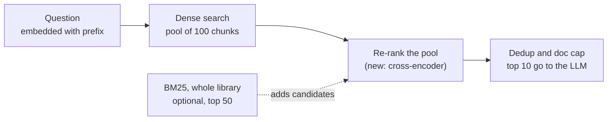
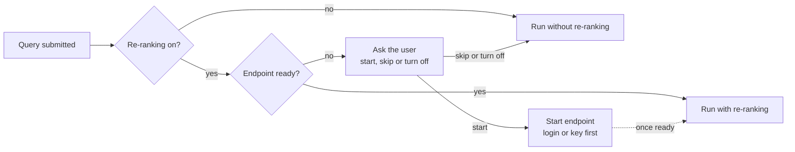

# Re-ranking for zotero-rag: summary and brainstorm

2026-11-14. Exported from the brainstorm doc of the project thread "Improve recall with a re-ranking step". This is a historical record; the implementation plan is `docs/superpowers/plans/2026-11-14-reranking.md`.

Working idea: re-ranking as an optional, preset-defined step. A multilingual cross-encoder rescores the candidate pool before the per-document cap. It runs on the server's own CPU within a 15 s budget, or on a GPU endpoint (MPCDF or RunPod) that each user starts with their own credentials. Users can turn it off in Preferences or per query, and a query never waits for it. Still a brainstorm; the eval below would pick the model and pool size.

## What the recall experiments found

Five rounds of experiments on the gold library (`groups/6297749`, 16 gold questions, 178-question retrieval benchmark) since 2026-10-14. Only the query prefix moved the needle.

| Date | Change | Result | Status |
| --- | --- | --- | --- |
| 2026-11-13 | Instruction prefix on queries (`Instruct: ...\nQuery: ...`) | P@10 .674 to .742 (Docling), .669 to .753 (Kreuzberg); gold facts in top 10: 7 to 12 and 9 to 14 of 26 | Merged (PR #106), not yet confirmed by a judged run |
| 2026-11-13 | Whole-library BM25 fused with vectors (RRF, equal weights) | Best benchmark P@10 (about .79), but only for English; pushes cross-lingual gold facts down (7 to 4) | Needs a language guard |
| 2026-11-13 | Document title prepended to embedded chunks | About +3 pts P@10 on top of the prefix, not significant | Bundle with next re-index |
| 2026-10-14 | Query decomposition into 3 or 5 sub-queries | No gain; sub-queries rank answer passages lower than the full question | Flag off |
| 2026-10-14 | Embedding near-duplicate removal (0.97 to 0.90) | No gain; the per-document cap already handles near-copies | Flag off |
| 2026-10-14 | Re-index at 1600 chars | Judged recall +0.015 / +0.019, n.s.; context doubles, citation support drops | Not recommended |

Sources: `docs/history/extractor-evaluation.md`, the Hugging Face store (`evaluations/chunk-size-20261014/`, `evaluations/retrieval-variants-20261014/`, `evaluations/retrieval-improvements-20261113/`).

What this leaves for a re-ranker:

- **In reach:** the answers to Q02, Q05 and Q08 sat at ranks 15 to 94 before the prefix, inside the 100-chunk pool. A better scorer over that pool can lift them into the top 10.
- **Out of reach:** Q09's passages rank 1300 or lower. No re-ranker over a 100 to 200 pool can see them; only a different candidate generator (whole-library BM25) or a query rewrite can.
- **Constraint:** KISSKI chat and embedding calls share one counter of 400 per hour and 800 per day, and KISSKI lists no re-ranker model.

## Where it fits in the pipeline

The re-ranker belongs right after the vector search returns its raw pool and before text dedup and the per-document cap in `rag_engine.py`, the same slot the BM25 blend (`lexical_rerank.py`) and the embedding MMR prototype already use.



Re-ranking before the cap matters: the cap then keeps each document's best chunks by the sharper score, not by cosine. The pool is already fetched today, so the step adds no Qdrant calls; it replaces the role of the off-by-default BM25 blend rather than stacking on it.

## How it could fit into the product

A design sketch, not a plan: re-ranking would be a third, optional part of a preset next to `embedding` and `llm`, with its own provider, its own Preferences section and a switch in the query dialog.

**Preset.** An optional `rerank` section; no section means no step, as today. A local variant needs no credentials:

```json
"rerank": {
  "model_type": "local",
  "model_name": "BAAI/bge-reranker-v2-m3",
  "pool_size": 100,
  "timeout_seconds": 15
}
```

A remote variant would name a provider with `"model_type": "remote"` and `"provider": {"id": "mpcdf" | "runpod", "scope": "user", ...}`, the provider's options describing the endpoint to start (for MPCDF the vLLM preset: model, machine, GPU, run time, `--enforce-eager`).

**Three ways to host it.**

| Host | Who pays, whose credentials | Startup | Extra latency (estimate) |
| --- | --- | --- | --- |
| Local CPU on the zotero-rag server | Nobody; no credentials | Model loads once per process | Up to about 15 s, depends on model and pool (see below) |
| MPCDF LLM service | Free; each user's own MPCDF login (password + one-time code), session lasts about 12 h | 1 to 6 min queue plus model load; renewed while in use | Under 1 s plus network |
| RunPod serverless | Each user's own RunPod key and account | Scale-to-zero; a cold start takes seconds to minutes | Under 1 s when warm |

**RunPod.** The existing `runpod` provider already provisions a per-user serverless endpoint from the user's key and derives its URL from the key, so a `rerank` side fits its model. What is open is the worker image: it must answer a `/rerank` request (vLLM's or Infinity's serving formats do); whether RunPod's stock workers expose that route needs checking. Costs land on the user's own account, with pause to stop billing, as for the other RunPod sides.

**Credentials, per user only.** The MPCDF and RunPod terms don't allow sharing an account, so a remote rerank side would accept only the `user` scope. RunPod keys travel per request like today's user keys. An MPCDF login can't be a header: the backend would keep one `ProvisioningManager` per Zotero user, with the session sealed through `secret_store.py`, and the plugin would render a login form (user name, password, one-time code) from a new credential kind in the provider descriptor, keeping vendor names out of the plugin. The same reasoning applies to today's shared MPCDF embedding and LLM sides and the `managed` RunPod sides; moving those is a separate question, harder for the embedding side because auto-indexing runs without a user present.

**Preferences.** A "Re-ranking" section, shown only when the preset has one: provider, status, the key or login form, start and stop, and a "Use re-ranking" switch.

**Query dialog.** "Disable re-ranking" in Advanced options next to "Disable query routing", shown only when the preset has re-ranking, remembered like the routing box. The trace would say whether re-ranking ran, was off, was skipped because the endpoint was not ready, or failed, with each source's rank before and after.

**Endpoint not running.** The user is asked once, and the query itself goes ahead either way:



While the endpoint starts, queries run without re-ranking; once it reports ready, later queries use it. A local re-ranker skips the question entirely.

## Model choice

A cross-encoder, not an LLM: with KISSKI out as a re-ranking provider, the step runs locally or on an MPCDF or RunPod GPU, and bge-reranker-v2-m3 is the first candidate for all three. A cross-encoder reads question and chunk together and scores each pair, which is much sharper than the cosine we rank by now, especially for the numbers and names #90 found under-ranked.

Sizes and licences from the model cards as remembered at the time; check before adopting:

| Model | Size | Languages | Licence | Local CPU | MPCDF / RunPod (vLLM) |
| --- | --- | --- | --- | --- | --- |
| BAAI/bge-reranker-v2-m3 | 568M | 100+, cross-lingual | Apache 2.0 | Possible within 15 s with pool or precision cuts | Yes; needs no JSON override |
| Qwen/Qwen3-Reranker-0.6B | 0.6B | 100+ | Apache 2.0 | Similar to bge | Only a pre-converted seq-cls checkpoint (the official one needs a JSON override the MPCDF form strips) |
| mixedbread-ai/mxbai-rerank-base-v2 | 0.5B | 100+ | Apache 2.0 | Similar to bge | Untested |
| cross-encoder/mmarco-mMiniLMv2-L12-H384-v1 | 118M | Multilingual (mMARCO) | Apache 2.0 | About 1 to 3 s, the cheap baseline | Not worth a GPU |
| jinaai/jina-reranker-v2-base-multilingual | 278M | 100+ | CC BY-NC | Excluded by licence | Excluded by licence |

The English-only `ms-marco-MiniLM` family is not an option, since several gold questions are asked in French, German or Spanish about English text.

## Hosting option: MPCDF LLM service

The MPCDF LLM service is the most attractive GPU host for a re-ranker: free to the institute, on MPCDF GPUs (Viper, MI300A), and the [mpcdf-llm](https://gitlab.mpcdf.mpg.de/cboul/llm-mpcdf) library already solves the 8-hour job limit by renewing endpoints automatically.

How the [pte-plugins mpcdf-llm plugin](https://github.com/mpilhlt/pte-plugins/tree/main/plugins/mpcdf-llm) uses the library, as a model for zotero-rag:

- **Presets.** One preset per endpoint: framework (vLLM or Ollama), model, machine, GPU type and count, run time, queue time, extra arguments. A re-ranker would be a vLLM preset with `BAAI/bge-reranker-v2-m3` or `Qwen/Qwen3-Reranker-0.6B`; vLLM serves cross-encoders on its `/rerank` and `/score` routes (the extra arguments would select the scoring task).
- **Renewal.** A per-user supervisor (`ProvisioningManager.start_supervisor()`) starts a replacement before a job expires, while its "keep alive until" time is not reached, and switches over without interruption. Endpoints idle past a timeout are cancelled; each request calls `touch()` to count as activity.
- **Credentials.** The client never stores the endpoint key; it asks the manager for current credentials per request and refreshes once after a 401, 503 or connection error.
- **Session.** Login is MPCDF user name, password and one-time code; the session is stored Fernet-encrypted and lets the server renew while the user is offline, as long as the login stays valid.

What this would change in zotero-rag: today's `mpcdf` provider only probes a job whose URL and key an admin pastes by hand, which is a shared credential. With per-user sessions, the backend would keep one `ProvisioningManager` per Zotero user, as the plugin does per editor user, so each user's endpoint runs on their own MPCDF account.

What the library itself (README and `docs/provider-notes.md`) adds for a re-ranker:

- **Integration is small.** `ProvisioningManager` opens in the FastAPI lifespan with `start_supervisor()`; zotero-rag would mount the admin router behind its own auth and never mount the read router (it returns keys). The re-rank step asks the manager for current credentials, retries once after a 401 or connection error, and calls `touch()` so the endpoint is not idle-cancelled (default idle timeout 60 min).
- **Pick bge-reranker-v2-m3 first.** The spawn form strips every quote from the CLI arguments, so JSON flags break. Qwen3-Reranker on vLLM needs a JSON `--hf-overrides`; bge (an XLM-R sequence classifier) needs none, only the scoring task flag. A pre-converted Qwen3 "seq-cls" checkpoint would be the way around it.
- **Startup.** Every vLLM job needs a Hugging Face token. CUDA graph capture is very slow on the MI300A (about 53 s per batch size), so the preset should pass `--enforce-eager` or a small `--max-cudagraph-capture-size`. A 0.6B model should be ready within minutes once its weights are cached; queue times observed were 1 to 6 min.
- **Readiness.** The library treats an endpoint as ready only when the model appears in `/v1/models`, which also holds for a scoring model, so the existing readiness check works unchanged.
- **Hardware is oversized.** The smallest job is one MI300A for 1 to 8 hours, far more than a 568M model needs.

Open points:

- **Session upkeep.** A session lasts about 12 hours and also ends when the same user logs in to the MPCDF web interface. Each user would then be asked to log in again; until they do, their queries run without re-ranking.
- **One GPU per active user.** Per-user sessions multiply GPU use by the number of active users. Fine for a few users; worth raising with MPCDF before many use it.
- **AMD GPUs.** The provider notes list no cross-encoder tried on the MI300A yet (default image `vllm/vllm-openai-rocm:v0.30.0`). One manual start of bge-reranker-v2-m3 would settle it.
- **Packaging.** The library is not on PyPI; zotero-rag would pin it by git commit, as the plugin does, and the container build needs access to gitlab.mpcdf.mpg.de.
- **Eval.** Cloud sessions reach the GitLab repository but not the MPCDF service itself, so offline tests stay on CPU.

## Pool size, latency, cost and languages

Start with the existing pool of 100 and test 50 and 200. With 15 s of extra latency acceptable, the server's own CPU becomes a real option, which makes the local variant the natural default: no credentials, no provisioning, nothing to prompt for.

**Pool size.** The in-reach answers sat at ranks 15 to 94, so 100 is the minimum that covers them; 200 buys margin after the prefix reshuffled ranks. Beyond 200 the cost grows while Q09-type misses (rank 1300+) stay out of reach. The diversity escalation already multiplies the pool, so the re-ranker needs a hard cap (for example 200) independent of it.

**Hybrid candidates.** The strongest pairing is to let whole-library BM25 nominate extra candidates (say its top 50) and let the re-ranker score the union. That sidesteps the open problem from 2026-11-13: BM25 no longer needs a fusion weight, it only proposes, and a multilingual cross-encoder decides. BM25 nominees that are wrong for a cross-lingual question simply score low.

Latency and cost per query, for 100 chunks of about 200 tokens each. Rough estimates from typical throughput, not measurements; the eval measures them:

| Option | Extra latency | Cost | Notes |
| --- | --- | --- | --- |
| mMiniLM (118M) on 4 vCPU | About 1 to 3 s | None | Weakest model |
| bge-reranker-v2-m3 on 4 vCPU, fp32 | About 10 to 30 s | None | Over budget at pool 100; pool 50 roughly halves it. About 2.3 GB RAM, more than the cloud-server preset's 2 GB budget |
| bge-reranker-v2-m3 on 4 vCPU, int8 ONNX | About 4 to 12 s | None | Quantization typically gives 2 to 3 times the speed; about 0.6 GB RAM; quality loss to measure |
| bge-reranker-v2-m3 on Apple Silicon (MPS) | About 1 to 3 s | None | Local dev preset |
| MPCDF, 1 x MI300A | Under 1 s plus network | Free; one GPU job per active user | Queue and model load when not running |
| RunPod serverless GPU | Under 1 s when warm | The user's own account, per second of GPU | Cold start when scaled to zero |

A full answer already takes several seconds of generation, so a few seconds of local re-ranking is a modest share; 15 s is the stated ceiling.

**Languages.** The gold set mixes English sources with French, German and Spanish questions, which is exactly what broke BM25 fusion. Only multilingual, cross-lingual models qualify (bge-reranker-v2-m3, Qwen3-Reranker, mxbai v2, mMiniLM). The eval must report results split by query language and by cross-lingual pairs, not only the average, so a re-ranker that helps English but hurts the rest is caught. German umlauts lost in Kreuzberg's OCR text will hurt any re-ranker the same way they hurt BM25.

## How to evaluate it

The existing setup can answer the question for about 100 KISSKI chat requests in total, if the cheap retrieval-only stages go first and only a winner gets a judged run.

1. **Retrieval-only, offline (no chat requests).** Add re-rank variants to the 2026-11-13 script (`tools/variants.py`) on the Docling and Kreuzberg 800 snapshots. Baseline is `dense/acad`, the prefix that now ships. Variants: mMiniLM, bge-reranker-v2-m3 in fp32 and int8 ONNX, Qwen3-Reranker-0.6B (seq-cls), each at pools 50, 100 and 200, plus dense and BM25 candidates combined. Query embeddings for the 194 questions are cached once (up to about 200 embedding requests, capped in the script).
2. **Report** P@1, P@10, MRR and gold facts in top 10 and top 30 of 26, split into English, non-English and cross-lingual, with exact McNemar against the baseline.
3. **CPU timing.** Wall time per query and peak memory for each variant on a 4-vCPU machine; the 95th percentile has to stay under 15 s.
4. **Gold facts in context (a few chat requests).** Run the winner through the real pipeline with generation mocked (`tools/cached_backend.py MOCK_LLM=1`), so the per-document cap and escalation act on the re-ranked pool. Count gold facts reaching the context, out of 39.
5. **Judged gold run (about 100 requests).** Prefix-only baseline versus the winner, same gold version and snapshot. The baseline run also gives PR #106 the judged confirmation it still lacks.

A model would be worth adopting if gold facts in the top 10 rise by at least 3 of 26 without losses on non-English questions, benchmark P@10 improves at p below .05, and the local variant stays within 15 s on 4 vCPU. MPCDF and RunPod timings can only be measured once a user endpoint runs there.
